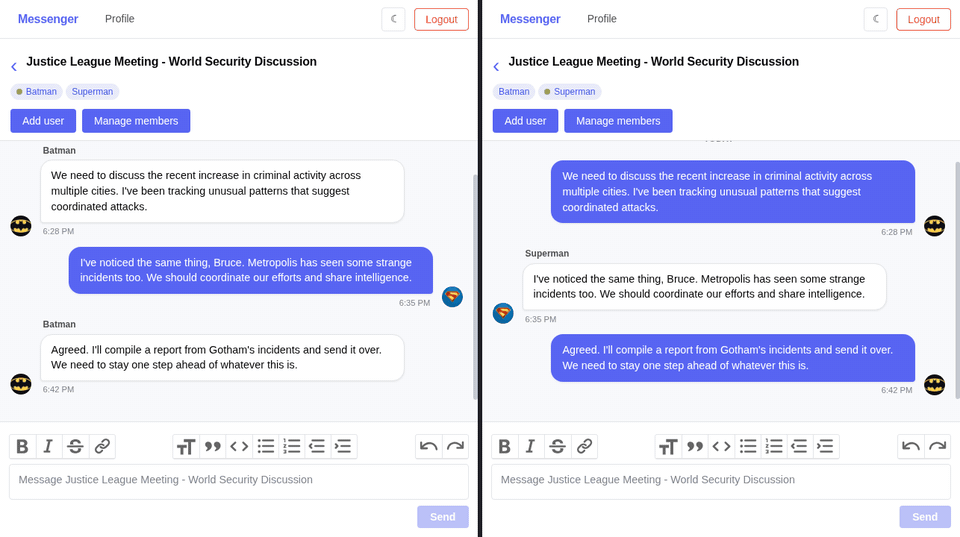
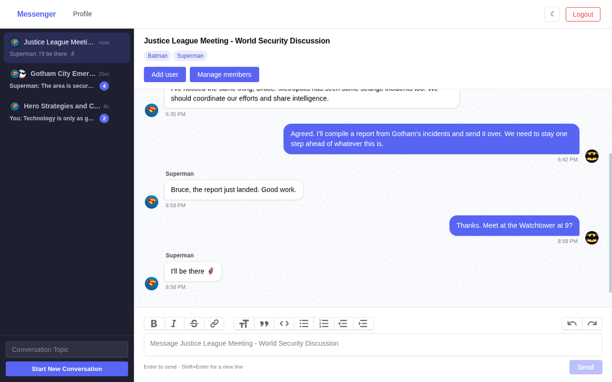
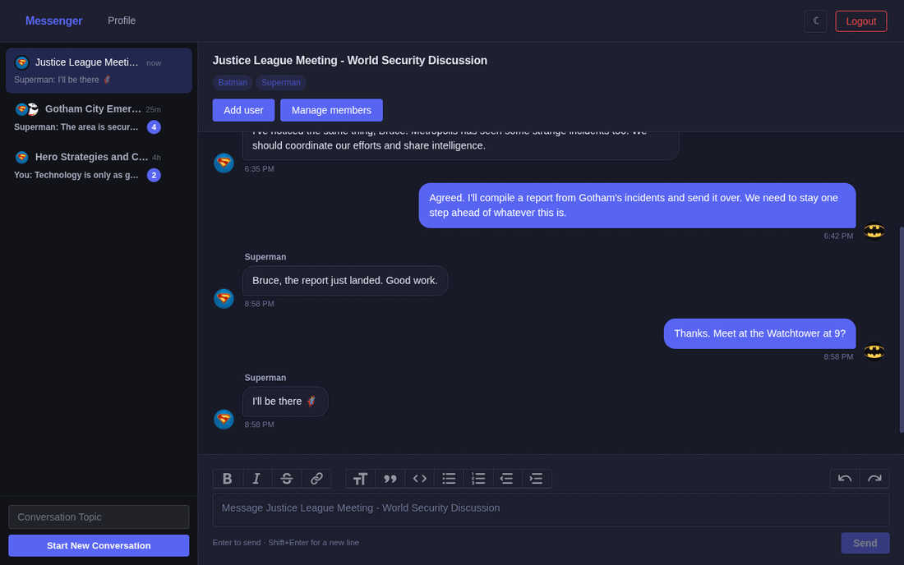
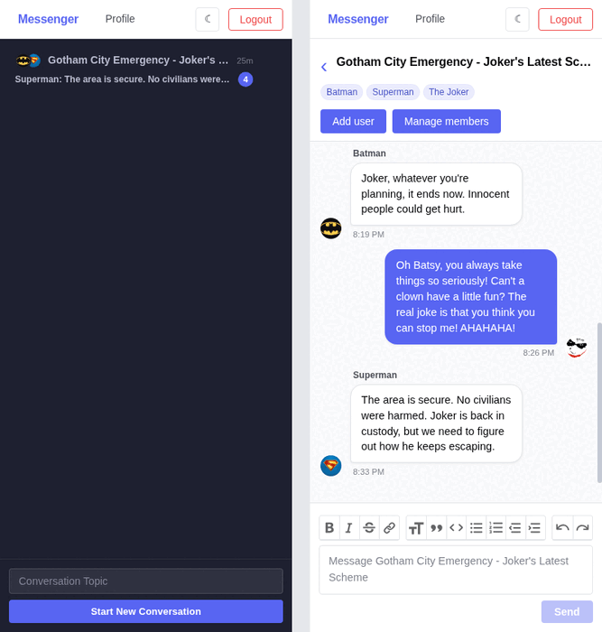
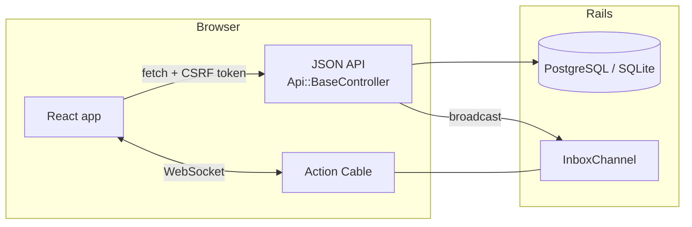

# Messenger

[](https://github.com/NikEmman/messenger/actions/workflows/ci.yml)

A real-time group chat app built with **Rails 8** and **React**. Messages, typing indicators and presence update live over WebSockets.

**[Try the live demo →](https://messenger-lr1s.onrender.com)**: click a demo account on the sign-in page, no sign-up needed. Open a second (private) window as another hero to watch messages arrive in real time.



## Features

- **Real-time messaging** over Action Cable: new messages, typing indicators, online presence and membership changes appear without refreshing
- **Group conversations**: create a conversation, search for people and add or remove members
- **Unread counts** per conversation, with conversations sorted by latest activity
- **Rich text messages** (bold, lists, quotes, code) with a Trix editor; Enter sends, Shift+Enter adds a line
- **Optimistic sending**: messages appear instantly and failed sends can be retried
- **Infinite scroll** through message history, loaded 30 messages at a time
- **Message grouping** by sender with Today / Yesterday separators
- **Profiles with avatars**, viewable by clicking a member
- **Responsive**: separate list and chat screens on phones
- **Dark mode**

| Desktop | Dark mode | Mobile |
| --- | --- | --- |
|  |  |  |

## Architecture

A single Rails app serves the React bundle (built with esbuild) from one HTML page and exposes a JSON API under `/api`. The same session cookie authenticates both the API and the WebSocket.



- **One stream per user.** Each user subscribes to their own `InboxChannel`. Sending a message broadcasts it to every member's stream, so one subscription keeps the sidebar and the open chat in sync.
- **Authorization by scoping.** Every lookup goes through the current user, e.g. `current_user.conversations.find(id)`, so other people's conversations return 404. Client-supplied `user_id`s are ignored.
- **Lean list endpoint.** The sidebar gets summaries (last message preview, unread count) in a fixed number of queries. Full history is fetched page by page with cursor pagination (`?before=<id>`), which stays stable while new messages arrive.
- **Optimistic UI.** The client tags each outgoing message with a `client_id` that the server echoes back. Whichever arrives first, the HTTP response or the broadcast, replaces the pending copy, with no duplicates.
- **Security.** CSRF protection is on, with the token refreshed on login and logout through a response header. Message HTML is sanitized before rendering. Serializers whitelist fields, so password digests are never sent.
- **Rails 8 "Solid" stack.** Production runs Action Cable, the cache and background jobs on PostgreSQL (`solid_cable`, `solid_cache`, `solid_queue`), so there's no Redis to run.

### Tech stack

| Layer | Tools |
| --- | --- |
| Backend | Ruby 3.3, Rails 8, Action Cable, Action Text, Active Storage |
| Frontend | React 18, React Router 7, Trix, esbuild |
| Data | PostgreSQL (production), SQLite (development and test) |
| Testing | RSpec (request, model and channel specs), Jest + Testing Library |
| CI / deploy | GitHub Actions (RSpec, Jest, RuboCop, Brakeman), Render |

## Running locally

Requirements: Ruby 3.3.5 and Node 22 (versions are pinned in `.ruby-version` and `.node-version`), plus Yarn. No database server is needed in development; it uses SQLite.

```bash
git clone https://github.com/NikEmman/messenger.git
cd messenger
bundle install
yarn install
bin/rails db:prepare   # creates the SQLite database and seeds demo data
bin/dev                # Rails server + esbuild watcher on http://localhost:3000
```

Sign in with one of the seeded accounts (the sign-in page has one-click buttons for these too):

| Hero | Email | Password |
| --- | --- | --- |
| Batman | bruce.wayne@wayneenterprises.com | gotham123 |
| Superman | clark.kent@dailyplanet.com | krypton123 |
| The Joker | mrj@arkhamasylum.com | chaos123 |

### Tests

```bash
bundle exec rspec   # API, model and channel specs
yarn test           # React component tests
bin/rubocop         # style
bin/brakeman        # security scan
```

CI runs all four on every push and pull request.

## What I learned

- Designing a JSON API around authorization: scoping every query to the current user instead of trusting IDs from the client
- Building real-time features with Action Cable, and handling the races between HTTP responses and broadcasts
- Keeping list endpoints fast as data grows: summary payloads, SQL-side sorting and cursor pagination
- Integrating a Rails API with a React frontend in one deployable app, including CSRF handling for a single-page app
